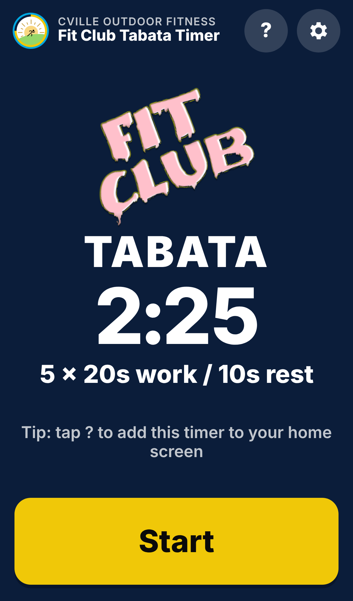
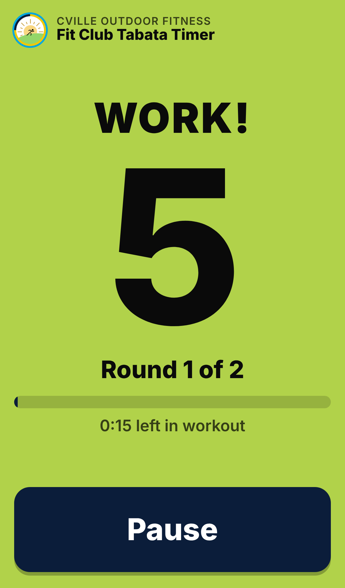
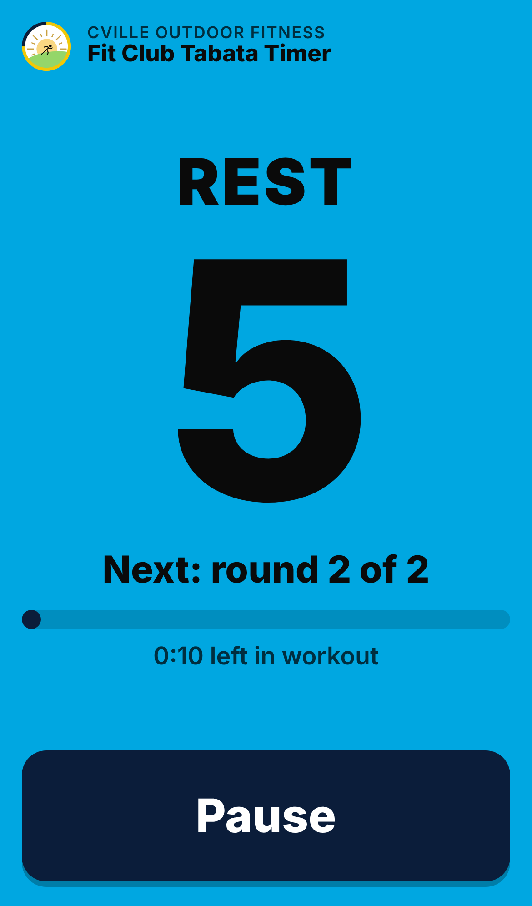
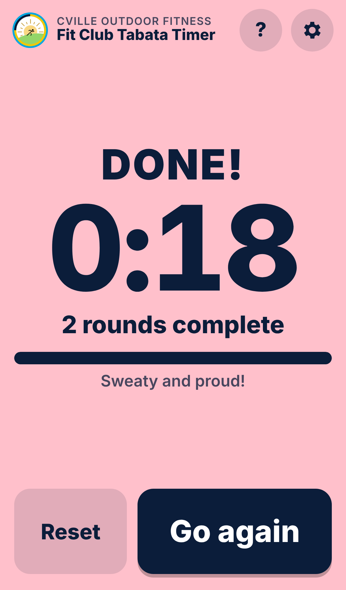

# Fit Club Tabata Timer

A Tabata interval timer for [Cville Outdoor Fitness](https://www.cvilleoutdoorfitness.org/) workouts.
It installs to your phone's home screen and works with no signal.

**Use it:** https://www.cvilleoutdoorfitness.org/tabata/

| Ready | Work | Rest | Done |
|---|---|---|---|
|  |  |  |  |

## Features

- Exercise, rest and interval count are adjustable (default 20 s / 10 s / 5 rounds), plus a 5 second get-ready countdown. Settings are remembered on the phone.
- Big, color-coded screens that read in sunlight: yellow = get ready, green = work, blue = rest, pink = done.
- Pick separate sounds for exercise start, rest start and finish: coach's whistle, beeps, boxing bell, plus silly ones (air horn, more cowbell, clown horn, duck, pew pew laser, slide whistle, video game, sad trombone, gong, or "surprise me").
- 3-2-1 beeps before each exercise, vibration on Android, and the screen stays awake while the timer runs.
- Fully offline after the first visit. All sounds are generated in the browser, so there are no audio files to download.

## Install it as an app

Open the link above once while you have signal, then:

**iPhone / iPad (Safari)**
1. Tap the **Share** button (square with an up arrow). On iOS 26 it's under the **•••** button.
2. Scroll down and tap **Add to Home Screen**.
3. Keep **Open as Web App** on and tap **Add**.

**Android (Chrome)**
1. Tap **Install app** in the timer's **?** screen, or open Chrome's **⋮** menu.
2. Tap **Add to Home screen** (or **Install app**), then **Install**.

Keep the timer on screen during the workout. Phones pause web apps in the background, so locking the phone or switching apps stops the sounds.

## Development

The app is plain HTML, CSS and JavaScript in [`app/`](app/) with no build step.

```sh
npm run serve      # http://localhost:8080
npm install && npx playwright install chromium
npm test           # phone-sized smoke test; writes docs/screenshots/
```

When you change any file in `app/`, bump `CACHE` in `app/sw.js` and `VERSION` in `app/app.js` so installed phones pick up the update.

Changes go through pull requests. CI runs the smoke test and attaches screenshots and a copy of the app to each PR; merging to `main` deploys to GitHub Pages automatically.
